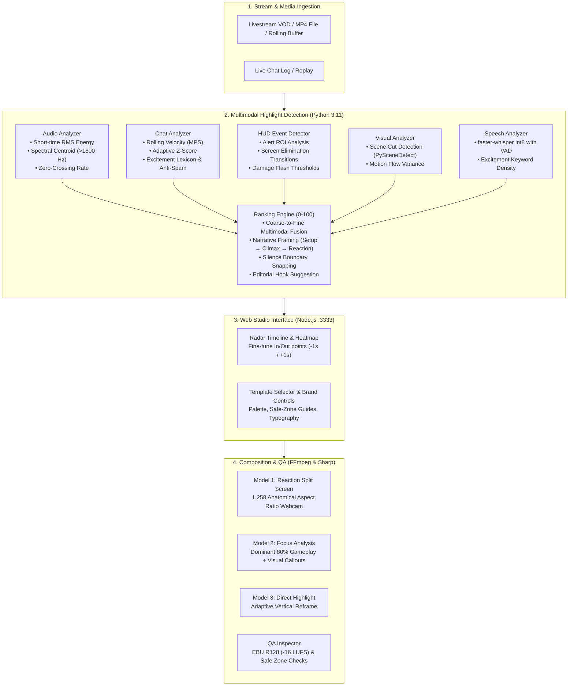

# GG NO CHAT — Vertical Video Studio & Multimodal Highlight Detection Engine

> An automated multimodal highlight detection and vertical short-form video creation studio for gaming livestreams and VODs.  
> Compliant with EBU R128 audio loudness standards and optimized for vertical (9:16, 1080x1920) platforms.

---

## Overview

**GG NO CHAT Studio** provides a modular pipeline combining an intelligent multimodal detection engine in Python with a real-time web studio and rendering pipeline in Node.js and FFmpeg.

It automates the process of finding viral-worthy moments in long gaming broadcasts and turning them into polished vertical clips with adaptive framing, synchronized captions, and customizable branding.

---

## System Architecture



---

## Visual Models

### 1. Reaction Split Screen
- **Facecam Alignment:** Preserves facial aspect ratio (817x650 / 1.258) without vertical squeezing.
- **Neon Divider:** Illuminated horizontal gradient divider with Roman numeral badge.
- **Karaoke Subtitles:** Word-by-word highlighted captions rendered within social media safe zones.

### 2. Focus Analysis
- **Dominant Media Area:** Maximizes vertical real estate with an 80% frame coverage for gameplay action.
- **Top Context Card:** Editorial header displaying key discussion points.
- **Interactive Callouts:** Highlight annotations anchored to on-screen details.

### 3. Direct Highlight
- **Vertical Reframe:** Adaptive focus on high-action segments with subtle ambient background.
- **Retention Hook:** Concise opening title positioned outside native platform UI buttons.

---

## Highlight Detection Engine

The detection worker implements a coarse-to-fine multimodal approach:

1. **Acoustic Fast-Scan (500x+ Real-Time):** 16kHz mono audio is analyzed for energy bursts and high spectral frequencies (screams, laughter, abrupt volume changes).
2. **Selective Speech Transcription:** Only candidate highlight zones are transcribed using `faster-whisper` with voice activity detection (VAD).
3. **Narrative Arc Preservation:** Clips automatically maintain a three-part structure:
   - **Setup:** 3-5 seconds of preceding context.
   - **Climax:** Peak event or trigger.
   - **Reaction:** 4-6 seconds of immediate streamer response.
   - **Boundary Snapping:** Clip boundaries snap to detected pauses in speech.

---

## Benchmark Results

Evaluated on a 57-minute livestream VOD (3,419 seconds total duration):

| Stage | Duration | Processing Speed |
| :--- | :--- | :--- |
| Acoustic Fast-Scan (3,419s) | 6.63s | 515.7x real-time |
| Peak Clustering & Ranking | 0.003s | Instantaneous |
| Targeted Whisper VAD (8 zones) | 17.56s | Efficient CPU int8 |
| **Total Engine Runtime** | **24.19s** | **141.3x faster than real-time** |

---

## Installation & Usage

### Prerequisites
- Node.js 18+
- Python 3.11+
- FFmpeg installed and available in system PATH

### Setup

```bash
# Install Node.js dependencies
npm install

# Install Python requirements
pip install -r requirements.txt
```

### Running the Studio

```bash
npm run studio
```
Access the dashboard at `http://localhost:3333`.

### Running the Detection Engine via CLI

```bash
python engine/highlight_detector.py --video path/to/stream.mp4 --output output/radar_highlights.json
```

### Running Test Suites

```bash
# Highlight engine unit tests
npm run test-engine

# QA audio/video compliance checker
npm run qa
```

---

## Project Structure

```text
├── assets/                  # Branding assets, fonts, lofi tracks, and overlays
├── engine/                  # Multimodal Python detection engine
│   ├── analyzers/           # Audio, chat, HUD, visual, and speech analyzers
│   ├── tests/               # Integration and unit test suite
│   ├── ranking_engine.py    # Multimodal scoring and narrative framing
│   └── highlight_detector.py# Main CLI pipeline worker
├── lib/                     # Node.js rendering and video composition modules
│   ├── templates/           # Split screen, focus analysis, and direct short templates
│   ├── renderer.js          # FFmpeg rendering pipeline
│   ├── qa_checker.js        # EBU R128 loudness and safe-zone verification
│   └── subtitle_builder.js  # Dynamic ASS subtitle generation
├── public/                  # Web Studio interface (HTML/CSS/JS)
├── scripts/                 # Dev and maintenance utilities
├── brand.json               # Brand configuration and palette
├── package.json             # Node.js scripts and dependencies
├── requirements.txt         # Python dependencies
└── server.js                # Express API and Studio server
```

---

## License

Distributed under the MIT License.
